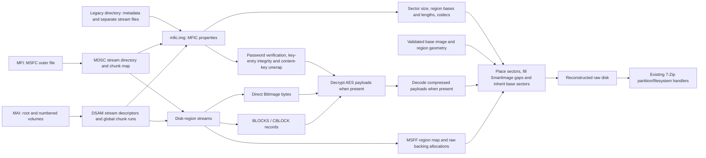

# Observed Miray MFI/MAI structures

Structures observed in known-content FullImage, SmartImage, BitImage, differential and overlay files
created with HDClone.
All integers are little endian. Unresolved fields are marked in the tables.
These notes are based on test images rather than a vendor specification.

The on-disk encodings below were determined from local fixtures.



Logical FullImages can omit unused space between an extended boot record and
a logical partition. Inter-region omissions read as canonical zeroes. Each
non-sparse region still requires complete stored coverage, and BitImages require
complete whole-disk coverage. Declared source-error or unfinished ranges remain
unavailable rather than becoming valid zeroes.

## Legacy directory images

A legacy image can be a directory containing `mfic.img` and separate files
named by its region properties. The metadata file begins directly with MFIC or
IMGC; it has no MSFC or MAI wrapper. Open `mfic.img` in 7-Zip. Region data uses
the same raw or framed records, codecs, passwords and key-entry checks as
container images. Required stream files must be present beside the metadata.
Native full restores also verify logical-stream segmentation using four-digit decimal or three-digit hexadecimal `.dat` names, and a bare
first file followed by hexadecimal suffixes such as `.1`, `.A`, and
`.0000000A`. Segment bytes concatenate into one logical stream; they have no MSFC header.
Missing middle or final segments fail the declared length and record checks.

The flat overlay pair is `data.ovl` and `mask.ovl`. For logical sector `s`, the
selection bit is `(mask[s / 8] >> (s % 8)) & 1`. A set bit selects
`data.ovl[s * sector_size : (s + 1) * sector_size]`; a clear bit inherits the
base. Native restores confirm this layout over plaintext and AES-256 parents.
These overlay bytes are plaintext, independently of base payload encryption.
Missing pairs, short masks and selected data beyond the backing file fail.

A directory can instead use an MSFF sidecar named `ovl.mfo`, or a
`mfo_locator.inf` path list. Entries contain a braced identifier and quoted
candidate paths after the `# Miray Image Overlay Pathlist` heading. The reader
checks the selected sidecar's parent identifier and geometry before composition.
7-Zip's volume callback restricts lookup to permitted relative paths; absolute
paths and paths containing `..` are not resolved by the standard applications.
Both the original disk and a valid composite appear as separate members.
The older `ovl_locator.inf` path list selects a directory containing
`meta.ovl`. Its type-21, kind-7 region names the data-file stem in `0x1000`
and mask-file stem in `0x100d`; both physical filenames end in `.ovl`.
The same sector-bit rule applies. Native restores verify this representation
over plaintext and AES-256 parents.

## MFI outer MSFC header

| Offset | Width | Observed role |
|---|---:|---|
| `0x00` | 20 | Signature `4d53464361115bc7b1f67a4a92fbacd373713e06` |
| `0x14` | 4 | Version, observed 1 |
| `0x18` | 4 | Data-region file offset, observed 65536 |
| `0x1c` | 8 | Data-region length |
| `0x24` | 16 | Identifier |
| `0x34` | 8 | Total container data length in the first segment; zero in continuation segments |
| `0x3c` | 8 | Segment count in the first segment |
| `0x44` | 8 | Split size; zero in observed unsplit files |
| `0x4c` | 8 | Zero-based segment index |
| `0x54` | 8 | Segment data offset in the reassembled container |
| `0x6c` | 4 | CRC32 of bytes `[0, 0x6c)` |

The reader supports single files and numbered `<stem>.001.mfi`,
`<stem>.002.mfis`, ... segment sets. Each continuation has its own MSFC header;
these headers are removed when joining the data ranges. IDs, CRCs, sequence
numbers, lengths and offsets must agree. Missing or mismatched volumes fail.
The current resource limit is 1024 segments. A file extension alone is not
sufficient for recognition. MAI volumes use a separate layout described below.

## MDSC stream directory

MDSC starts at the MSFC data offset. Its 80-byte header includes:

| Offset | Width | Observed role |
|---|---:|---|
| `0x00` | 4 | `MDSC` |
| `0x04` | 4 | Header size, 80 |
| `0x08` | 16 | Format identifier |
| `0x18` | 4 | Version, 1 |
| `0x1c` | 16 | Image/container identifier |
| `0x3c` | 8 | Chunk size, 1 MiB in fixtures |
| `0x44` | 4 | Number of physical chunks |
| `0x48` | 4 | First directory-entry offset relative to MDSC |
| `0x4c` | 4 | CRC32 of the logical `Stream0` bytes, with this field replaced by zero |

The first chunk contains the bootstrap entry and mapping for `Stream0`. The
logical directory can span noncontiguous chunks; entry and extra-record offsets
address that logical stream. A 60-byte stream entry has next-entry
offset at `+0`, record size at `+4`, kind at `+8`, stream ID at `+12`, logical
length at `+16`, a 32-byte name at `+24`, and an extent-list pointer at `+56`.

Kind 2 uses extent lists of linked records: next pointer `u32`, record size `u32`, then
physical chunk indices `u32[]`. Only `ceil(stream_length / chunk_size)` indices
are needed; list capacity can exceed that count. Chunk `i` is located at
`MSFC.data_offset + i * chunk_size`. Stream lengths exclude trailing slot padding.
`Stream0` refers to the internal directory data. `mfic.img` contains image
metadata; other names identify disk-region streams and their `.ix` indices.
The directory checksum covers the logical `Stream0` length, including its
header and extent records. Unused bytes after that length are excluded.
Both readers validate this checksum before interpreting image metadata.

Kind 0 stores inline data in the directory at the entry's extra-record offset
plus eight bytes. The first extra word is zero; the second is not a record
length. Inline data can cross directory chunk boundaries and is included in
the directory CRC. The 7-Zip reader resolves these bytes through `Stream0`'s
mapping. Directory and payload offsets use checked 64-bit arithmetic.

## MAI outer archive container

The observed initial magic is **`HSAM`**, rather than `MAI` or `MASC`. A matching
**`FSAM`** footer occupies the last 4096 bytes. Both accept versions 0 and 1 and matching
identifiers. Their CRC32 is computed over the complete record with bytes 8–11
replaced by zero.

Header fields: CRC-record size `u32@4`, CRC `u32@8`, version `u32@12`, identifier
at 16, physical chunk size `u32@44`, header size `u32@48`, and footer size
`u32@52`. The fixtures use 1 MiB chunks.
The physical header/footer slots are 4096 bytes, independently of their declared
CRC-record lengths. Native restores accept lengths from 12 through 4096 in the
tested profiles. CRC32 covers the declared length, with bytes 8 through 11 zero.

The footer has descriptor offset `u64@56` and descriptor length `u64@64`. Its
field at 52 is the actual chunk count, while the header's field at 52 is the
footer size. The footer's incompatible-feature word at 76 must be zero. A
nonzero word at header offset 64 is tolerated when a valid footer supplies the
final archive state; independent native restore tests verify that distinction.
The compatible-feature words at header offset 68 and version-1 footer offset
80 use bit 0 for archive modification. A finalized DSAM directory can still
contain a logically incomplete image identified by MFIC region markers and
global missing ranges. Physical finalization alone does not make all disk bytes
available.

The descriptor begins with `DSAM`, total byte length `u32@4`, CRC `u32@8`,
allocated descriptor chunks `u32@12`, stream-table offset `u32@16` and stream-table length `u32@20`.
Offset 12 is a rounded allocation count, not completion state. Native restores
also verify a five-chunk descriptor. The selected descriptor's allocation plus
its queued-chunk CRC count at offset 32 must fit the physical chunks remaining
from the descriptor to the data end. CRC32 covers the full descriptor with its CRC field
zeroed. The stream table starts with a `u32` count followed by 72-byte entries:

| Entry offset | Width | Role |
|---|---:|---|
| `0` | 32 | Name |
| `32` | 4 | Stream kind: 0 empty, 1 inline, 2 chunk-backed, 3 chunks followed by inline data |
| `36` | 4 | Stream revision counter; not a feature-flags whitelist |
| `40` | 8 | Logical stream length |
| `48` | 4 | Inline-data offset relative to descriptor |
| `52` | 4 | Inline-data length |
| `56` | 4 | Extent-run table offset relative to descriptor |
| `60` | 4 | Extent-run table byte length |
| `64` | 4 | Stream checksum-list offset relative to descriptor |
| `68` | 4 | Stream checksum-list byte length |

Small metadata/index streams can be entirely inline. Other streams use pairs
of `u32 first_chunk, u32 number_of_chunks`. Their physical byte range begins at
`header_size + first_chunk * chunk_size`. A native interrupted kind-3 stream
consumes the external runs before the inline tail. Mutable snapshots can retain
a redundant inline tail after those bytes have been copied into an external
allocation. Reads stop at the logical stream length; an external allocation
large enough to cover it makes that retained tail unreachable. When external
storage is shorter, it and the inline tail must cover the logical length.

The native descriptor parser preserves the full 32-bit revision value. Its
stream-resize path increments that value. Native checkpoint completion produces
values 1 and 5 in addition to the initial values 0, 3 and 4. Revision values do
not select payload decoding; stream kinds, lengths and extents determine it.
The reader checks those structural fields independently.

Native empty streams use kind 0 with zero logical size and zero inline, extent
and checksum offsets/lengths. Empty differential index streams use this form.

The header's synchronization interval at offset 56 enables recovery when its
final footer cannot be parsed. The reader scans descending interval boundaries
for a complete DSAM with a valid CRC and allocation. Snapshot runs can reference
data after the descriptor, without overlapping its own chunk allocation. Region
marker `0x1006` with initial zero counters requires deriving available sectors
from complete records. Missing ranges remain unavailable. Native restores and
seeded destination comparisons verify the retained ranges. A valid footer that
selects a damaged final DSAM remains an error.

A numbered `.mais` volume can be opened as a snapshot without the final root.
Its `XSAM`/`NSAM` records select its directory, and earlier numbered volumes
supply global chunk ranges. A native full restore from the last numbered
volume matches the source. Recovered snapshots carry a warning; unavailable
sectors and damaged record framing retain separate error reporting.

### Segmented MAI

The root `<stem>.mai` is the final volume, with `HSAM`/`FSAM` records. Earlier
volumes are `<stem>.001.mais`, `<stem>.002.mais`, and so on, with `XSAM`/`NSAM`
records. The reader accepts numbering widths from one to six digits and limits
the complete set to 1024 files.

Header offset 32 is the one-based volume ordinal, offset 36 is its first global
chunk index, and offset 40 is the selected maximum number of chunks per volume.
Footer offset 52 gives the volume's actual chunk count. Each file has a 4096-byte
header, that number of complete chunks, and a 4096-byte footer. Descriptor
positions in footers are local file offsets. Stream extent runs use global
chunk indices; chunk `c` is at `4096 + (c - first_chunk) * chunk_size` in the
containing volume. Descriptor chunks contribute to the global chunk numbering.

The configured maximum-chunk value is a writing target, not a strict bound on
actual volume lengths. Native resume can grow a prior root beyond that target
before moving it into a numbered volume. A verified resumed split image has a
five-chunk volume with a configured target of three. Its complete native restore
matches. Validate actual footer chunk counts against physical file lengths,
contiguous global ranges and the final root offset rather than rejecting an
otherwise valid volume solely for exceeding the target.

The final descriptor has a volume-table offset at 24 and length at 28. This
table contains a `u32` count and 16-byte records for the preceding volumes:
`u32 first_chunk, chunk_count, checksum_offset, checksum_length`. The readers
validate these ranges against the opened volume headers and footers. Missing
volumes, inconsistent identifiers, sequence numbers, sizes or CRCs fail.

The observed writer requires a split size of at least 100 MiB. Smaller test
sizes fail before image creation. For a selected size `s`, the header's chunk
limit is `floor((s - 8192) / chunk_size)`; both readers compare this with MFIC
property 15. An image that fits into one file can still retain a selected split
size and chunk limit.

### MAI stream checksums

A checksum list contains `u16 digest_length, u16 type, digest[digest_length]`
records and a four-byte zero terminator. Observed type definitions are 2=MD5,
3=SHA-1, 4=SHA-256 and 6=SHA3-256, with digest lengths 16, 20, 32 and 32.
Both readers check supported stream digests over the stream's stored bytes,
including block headers and encrypted payloads. Verification uses bounded
buffers and requires a complete pass over every stream that has a digest.
Truncated, duplicate, malformed or unsupported digest records are rejected.

The volume table uses the same digest-list encoding for physical segments.
Those digests cover the entire physical file: header, all chunks and padding,
descriptor, and footer. The final metadata volume has no self-digest. Native
file-information results confirm the association between these records and
complete segment files. Both readers validate all supported stored digests.

Digest-bearing fixtures are derived from native images. The native reader opens
the physical-digest fixture and reports values matching complete-file hashes.
Structural CRCs, content digests and fixed-key integrity trailers do not establish
producer identity or certify that every archival authentication mechanism has
been identified.

## Shared MFIC metadata

`mfic.img` has an eight-byte `IMGC`, version-1 preamble, or a twelve-byte
`MFIC`, version-2, -3 or -4 preamble. The extra word at offset 8 in the latter
form is preserved; a nonzero value does not prevent native restoration.

Properties follow the preamble as `u32 raw_tag, u32 byte_length,
byte value[length]`. The usual twelve bytes at offsets 12–23 are the first
property, key 7, rather than part of a fixed header. This property selects the
encoding for subsequent text: 1 means UTF-8; 0, also the default when absent,
uses the native signed-byte widening convention. Its value can occupy one to
four little-endian bytes. It can appear after other properties.

The logical key is `raw_tag & 0x7fffffff`. Bit 31 marks a mandatory property:
an unknown mandatory key fails to open; an unknown optional key is bounded and
skipped. Original tag and payload bytes remain part of the region integrity
input when they occur inside a region.

Global properties include:

| Key | Observed value |
|---|---|
| `0` | Image filename |
| `1` | Creator name |
| `2` | Creator/version description |
| `4` | Seven-byte creation date/time |
| `6` | Logical sector size; native restores verify powers of two from 512 through 65536 bytes |
| `7` | Encoding for subsequent text: 0=native byte widening, 1=UTF-8 |
| `8` | 32-byte password verifier, when protected |
| `9` | 32-byte password salt, when protected |
| `10` | Password scheme: 1 or 2 for legacy derivation, 3 for key-store entries |
| `11` | Encryption: 0=none, 1=AES-128, 2=AES-256 |
| `12` | Total disk sector count |
| `13` | Image identifier, 16 bytes |
| `14` | Base-image identifier for differential images, 16 bytes |
| `15` | Split size; all ones in unsplit files, 2 MiB in the split fixture |
| `17` | Creation method, 1–28; common MFI full=8, Smart=9, direct BitImage=10, differential=14, framed BitImage=20; common MAI full=24, Smart=25, direct=26, framed=28 |
| `19`, `20`, `21` | Source device name, serial, firmware |
| `26` | Recorded base-image filename or path, using the current text encoding |
| `0x2000` | Serialized key store and additional partition information |

Global keys 12 and 17 can be absent in either metadata preamble. When the disk
size is absent, the reader uses the greatest declared region end, with the same
overflow and range limits as an explicit size. When the type is absent, a single
kind-4 or kind-5 region identifies a direct or framed BitImage; kind-8 regions
identify a differential image. Regions of kinds 1 through 3 use the SmartImage
gap policy. Explicit zero or unknown types and sizes are not replaced by inferred
values. Complete native restores verify the absent fields in both containers,
including encrypted direct and sparse images.

Container directory names use UTF-8 and occupy at most 32 encoded bytes.
Region and mask names use the encoding active at their individual properties.
Encoding directives can repeat without changing already decoded names. External
legacy stream names are not restricted by the fixed container field; native
restores verify longer names and non-Latin names.

A zero-length key 5 starts a disk-region descriptor; zero-length `0x1008` ends
it. Additional-data property `0x2000` belongs to an open region, or to the image
after the terminator. Optional keys at or above `0x1000`, including keys above
`0x2000`, remain in the open region and its integrity prefix. Chunk names alone
do not establish scope. Within each
descriptor:

| Key | Observed value |
|---|---|
| `0x1000` | Container stream name |
| `0x1001` | Region base LBA in reconstructed disk |
| `0x1002` | Stored stream byte length |
| `0x1003` | Number of sectors actually stored in this region |
| `0x1004` | Highest stored region-relative sector index |
| `0x1007` | Region type; 1=filesystem, 2=partition table, 3=gap, 4=direct disk data, 5=framed whole disk, 8=differential region |
| `0x100a` | Logical region length in sectors, including omitted sectors |
| `0x100b` | Compression enum: 0=none, 1=zlib, 2=LZ4, 3=LZMA1 |
| `0x100c` | Codec properties; five LZMA1 bytes observed |
| `0x100d` | Optional secondary stream name; legacy mask file stem |
| `0x100e` | Repeated region checksum: four-byte method followed by digest bytes |
| `0x1006` | Empty uninitialized-region marker; direct raw checkpoints retain initial counters |
| `0x1008` | Empty region terminator |
| `0x1009` | Empty incomplete-region marker in cancelled framed images |

The tested full-image regions cover the whole disk consecutively. A simple
MBR/ext4 disk produced three streams: MBR sector 0, gap sectors 1–2047, and the
filesystem starting at sector 2048. Treating the metadata as one flat map loses
these repeated descriptor keys and cannot reconstruct ordinary partitioned
images correctly.

The sum of block sector counts equals `0x1003`; block addresses range within
`0x100a`. The final stored sector agrees with `0x1004`. These values differ in
SmartImages because unused sectors are omitted.

Counts, stored byte lengths and region lengths can use one to eight
little-endian bytes.
Encryption, region-kind and codec enums use one to four. Global sector size,
split selection and image type use eight bytes. An unsplit image can record
either zero or all ones as its split selection. Compact counts do not reduce
the reconstructed disk's address width.
Region start addresses retain all-ones high bytes above a short payload.
Ordinary positive start LBAs therefore require all eight bytes; treating a
short start address as zero-extended changes the native interpretation.

Region checksum methods 1–7 have digest lengths 4, 16, 20, 32, 64, 32 and 64.
The reader checks decoded region contents before extraction. Methods 1–5 are
CRC32 (little endian), MD5, SHA-1, SHA-256 and SHA-512. The last two selections
accept SHA3-256/SHA3-512 and the SHA-256/SHA-512 values emitted by the examined
native producer for those selections. A native whole-disk fixture verifies all
seven entries. Repaired metadata authentication does not hide an altered region
digest: independent corruption controls still fail to open. A region containing
unavailable source data cannot receive a successful checksum verification.

Self-contained SmartImages (types 9/25) can have holes before,
between, or after stored blocks, and outside described regions. The readers
expose omitted sectors as zero. Those bytes are a canonical representation for
filesystem access; their original contents were not archived and cannot be
recovered from this image. Full-image types still require complete coverage.
Differential images inherit absent sectors from a validated base image, as described below.

A filesystem region can contain zero stored sectors and a valid terminal
record without an incomplete marker. Its absent contents follow the SmartImage
zero policy. That metadata alone does not establish whether the original
operation finished or whether the region was intentionally omitted.

Key 15 contains the selected split size. Split MFI sets can retain the all-ones
unlimited selection while MSFC offset `0x44` records the physical split limit.
Disabled and automatic split modes can retain a finite selected size while the
physical file remains unsplit; native restores verify both combinations.
Otherwise, the selected size must match that limit. Native differentials use
zero, including split MAI differentials.

Region kind 4 stores direct sector bytes without BLOCKS headers or an index.
The region name selects its stream; `data` is a producer convention. The codec
must be Copy. MFI and MAI use the same direct grammar, independently of the
creation-method label. Native full restoration verifies a renamed direct MFI
region labeled as a FullImage. The tested native consumer feature-gates direct
MAI output; independent readers verify its bytes, encryption and split volumes.
Framed BitImages use the block records below and a whole-disk region (kind 5). All these full-image forms require
complete disk coverage. A BitImage sample decodes to 8,068,792,320
bytes; both independent readers produce matching output hashes.

MFI region kinds 11 through 13 use MSFF maps backed by raw allocations, without
BLOCKS framing or an index stream. Their stored-byte and stored-sector metadata
can remain zero after writing. The map's geometry is relative to its region;
all-ones pointers supply canonical zeroes because no parent is bound. These
backing bytes bypass the ordinary region codec and payload cipher. Native and
independent full-disk comparisons verify single regions, partitioned regions,
zero maps, split files and 4096-byte sectors.

## Passwords and encryption

Password protection alone has encryption enum 0 and leaves sector data
unencrypted. The readers still require and verify the password before exposing
disk contents. AES-128/256 leave directory, metadata and block headers readable;
the sector payloads are encrypted.

Password methods 1 and 2 use UTF-8 password bytes without normalization:

```
H0       = SHA256(UTF8(password))
Kp1      = SHA256(salt || UTF8(password))
Kp2      = SHA256(salt || H0)
verifier = SHA256(salt || selected_password_key)
```

The calculated verifier must match global property 8. Property 9 contains the
salt. Legacy global password schemes 1 and 2 select `Kp1` and `Kp2` directly,
without a `KSTO` record. AES-128 uses the first 16 bytes of that derived key;
AES-256 uses all 32. Password-only images verify the same calculation and leave
sector payloads unencrypted. Native complete restores verify both schemes and
both containers, including Unicode passwords. Missing and incorrect passwords
are rejected.

When `KSTO` is present, each entry's password method selects the verifier and
its key mode selects content-key recovery. Additional-data chunks without a
key store do not change a legacy image's password scheme. Key-store entries
retain their integrity checks; legacy schemes have no key-entry trailer.

Content keys can be derived from the password or stored as wrapped 16- or
32-byte keys in the `KSTO` chunk of property `0x2000`. The initial word counts additional chunks:
the encrypted BitImage fixtures have one (`KSTO`); logical images have two
(`KSTO` and `PRTD`). Chunks have a four-byte tag and a `u32` payload length.
The readers find `KSTO` independently of chunk order and validate every chunk's
bounds. For the observed single-entry key store:

| Property-relative offset | Width | Meaning |
|---|---:|---|
| 4 | 4 | `KSTO` |
| 8 | 4 | Chunk payload length; chunk ends at `12 + length` |
| 12 | 4 | Key-store version 0 or 1 |
| 16 | 4 | Entry count; bounded to 4096 |
| 20 | 4 | Entry byte length |
| 24 | 4 | Declared entry header size; ordinary entries use at least 40 bytes |
| 28 | 4 | Integrity algorithm, supported value 0 |
| 32 | 4 | Image-format wrapping key slot 5 or 9 |
| 36 | 4 | Content-key mode, 0 through 5 |
| 40 | 4 | Stored key length, 0, 16 or 32 |
| 44 | 4 | Password verification method, 0, 1 or 2 |
| 48, 52 | 4 each | Lengths of two opaque auxiliary byte strings |
| 56 | 4 | Creator label length |
| `20 + header_size` | 0/16/32 | Stored key bytes |

| Key mode | Content-key calculation |
|---:|---|
| 0 | No encrypted content key |
| 1 | AES-256 key is `Kp1`; no stored key bytes |
| 2 | AES-256 key is `Kp2`; no stored key bytes |
| 3 | Decrypt stored key with AES-256 ECB using `Kp2` |
| 4 | Decrypt stored key with AES-256 ECB using the selected format slot |
| 5 | Decrypt with `Kp2`, then with the selected format slot |

Each encrypted mode completed full official restores in both containers.
Mode-4 images without password metadata open without a password; their disk
payload remains encrypted. Modes that require a password reject missing or
incorrect credentials. Header extensions precede the stored key and remain
covered by the integrity trailer; nonzero 44- and 64-byte headers completed
full official restores. An unknown integrity algorithm is rejected by both
readers even when another valid entry is present.

The stored key is followed by the two declared auxiliary byte strings and the
creator label, then the trailer. Nonempty auxiliary fields completed official
restores; the reader validates and authenticates their bytes. Compact 16- and
20-byte entries with no password or encrypted content use zero defaults for
omitted fields. Short encrypted entries in the comparison set are rejected by
the native reader and this handler.

Sector payloads use independent AES ECB blocks with the recovered content key.
Compressed payloads include alignment bytes to a 16-byte boundary; codec
termination determines the useful compressed length. At most 15 trailing bytes
are accepted. Native resumed images can contain nonzero alignment bytes.
Native full restores also accept independently written nonzero tails with all
three compressed codecs in both containers. Raw sector payloads are already
aligned. Decryption precedes decompression.

Each supported key entry ends with a 32-byte integrity trailer. Its input is the
concatenation of serialized per-region property records, including region
attachments in property `0x2000`, followed by the complete key entry except its
trailer. Optional extension tags at or above `0x1000` are included while a
region is open, even beyond `0x2000`.
Property records retain their original tag, including bit 31, length and payload.
The key-5 region marker and global properties are excluded; the serialized
`0x1008` terminator remains part of the region prefix.

```
D       = SHA256(region_property_records || key_entry_without_trailer)
trailer = AES256_ECB_ENCRYPT(selected_wrapping_constant, D)
```

The readers decrypt the trailer and compare the digest before using an entry.
This check also applies to unencrypted entries with no content key. The input
scope was confirmed by native hash-call observations and all native fixtures
with supported entries match. The independent readers reject modified trailers,
creator labels and authenticated region properties. Native encrypted-consumer
controls restore even with a damaged trailer, so native acceptance does not
establish trailer validation. The fixed wrapping constants identify format encodings;
this integrity mechanism is not a secret-key proof of producer identity.
Version-1 stores can contain multiple variable-length entries. The readers select
entries using the supported slot, wrapping mode and password method; all usable
entries must unwrap to the same content key. Other recipient entries can coexist
with a supported entry. Stores with no supported entry, conflicting keys, other
store versions, or malformed lengths are rejected. Multiple-entry and reordered
chunk tests use derived fixtures; the native fixtures use single-entry stores.

A 3,310,419,968-byte MFI describes a 1,000,204,886,016-byte disk with
three region streams. The logical partition map contains FAT32 and Linux
partitions, plus an unallocated tail. It contains 13,634 stored blocks and
29,418,917 stored sectors. Native random access fills holes on demand, without
materializing a 1 TB output. Python raw export seeks over those holes and
truncates to the declared disk size; physical sparse-file support depends on
the output filesystem.

## Differential images

Native `.mfd` images use MFIC version 4, image type 14 and region kind 8. Either
MFI or MAI can provide the outer container. Their BLOCKS/CBLOCK streams store
changed sectors; all gaps inherit bytes from the referenced base. Empty change
streams contain only a terminal record. Unused SmartImage sectors in a base
retain the base reader's canonical zero representation.

Global properties 13 and 14 link the child and base identifiers. Property 26
records the base path. Readers use its sibling basename, validate the expected
identifier, sector size, logical disk size and region layout, and open the base
read-only. Absolute recorded paths do not direct reads outside the image's
directory. Missing bases, inconsistent identities and incompatible layouts fail.
Chains are limited to 16 images, including the final base; cycles are rejected
or reach that bound. Required passwords must also unlock the bases.

Split MFI differentials start with `<stem>.001.mfd` and continue with numbered
`.mfds` volumes. Split MAI differentials retain the `.mfd` metadata root and
numbered `.mais` volumes. Their split-size property can be zero while the physical volume header
retains a chunk limit. Numbered base-image volumes remain alongside the child.

Native fixtures cover MFI, MAI, AES-128, AES-256, SmartImage, unchanged disks and
segmented MAI. Both readers reconstruct the expected complete source contents.

## Disk data blocks

Disk-region streams contain framed records. Native rescue retry records can be
stored out of LBA order; the reader sorts their locations and checks overlap
and coverage before exposing logical data. The disk LBA is the sum of
the region-relative record LBA and the MFIC region base.

Uncompressed record:

```
12 bytes  "BLOCKS0.0.01"
u64       region-relative start LBA
u16       header checksum
u32       sector count
bytes     sector_count * logical_sector_size data
```

The checksum is a 16-bit one's-complement word sum. The first 22 bytes,
including the stored checksum, fold to `0xffff`; the count is excluded.

Compressed record:

```
12 bytes  "CBLOCK1.0.00"
u64       region-relative start LBA
u16       header checksum
u32       uncompressed sector count
u32       auxiliary word, normally zero
u32       packed byte count
bytes     compressed payload
```

Here the checksum covers the first **30** bytes, including the sector count and
auxiliary word. Native restores verify nonzero auxiliary values with corrected
checksums. The inspected decoder does not use this word to select payload decoding.
The compression method comes from the region's MFIC properties. A region with
compression enabled may also contain `BLOCKS0.0.01` records for incompressible
data; those records contain literal sector bytes. A controlled native fixture
with both compressed and raw blocks verifies this fallback. QuickCompress
uses independent [LZ4 blocks](https://github.com/lz4/lz4/blob/dev/doc/lz4_Block_format.md),
Normal uses zlib-wrapped Deflate, and Strong uses raw LZMA1. The LZMA properties
encode `lc/lp/pb` in byte 0 and the dictionary size in the next four bytes.

A terminal record has start LBA `0xffffffffffffffff` and ends after 22 bytes.
`BLOCKS0.1.01` is also accepted for raw records. A positive `u32` count from 1
through 4096 can follow a raw record as a compact continuation: its LBA follows
the previous physical record and its sector payload follows the count directly.
There is no new signature or checksum. A continuation needs a preceding raw
record and cannot follow a compressed record. Native restores verify these
forms in both containers, including AES-256 payloads. Zero counts are rejected.
The `.ix` companion streams contain observed pairs of `u64 stream_offset,
u64 start_LBA`; the prototype builds its own bounded index by scanning records.

## Source-error ranges

Per-region property `0x2000` can contain a chunk-count word and an `ELST` chunk.
The list payload is `u32 version=1, u32 count`, followed by pairs of
`u64 region_relative_sector, u64 sector_count`. Each range is positive, ordered,
nonoverlapping and contained within its region. A separate global `0x2000`
property still contains `KSTO`; the two scopes must not be conflated.

The complete serialized region attachment is included in the key-entry hash
prefix. Full-coverage layouts can omit records only where an error list accounts
for the missing source sectors. Direct BitImage can retain placeholder storage;
those bytes remain unavailable. Reads stop at an unavailable range and extraction
reports an error. Native direct MFI and AES-256/LZMA MAI fixtures identify one
unreadable source sector and preserve all surviving data.

Global `MLST` and `SLST` version-1 chunks use the same range encoding with
image-relative sectors. They identify pending or temporarily skipped input.
Their entries can occur in retry order, so coverage lookup sorts and merges
the ranges. These chunks can share a global additional-data property with
`KSTO` and the native resume-configuration object `RITC`, after the region's
`0x1008` terminator. Global additional data is excluded from the region-prefix
hash.

Gracefully cancelled compressed BitImages retain valid container metadata,
stored records, and marker `0x1009`. The reader reports unfinished ranges as
unavailable while preserving surviving data. Native cancellation/resume cases
cover password protection, rescue retries, and AES-256 with 4096-byte sectors.
Retained bytes match their original logical offsets, and completed native
resumes match the full sources.

Native cancelled FullImage and SmartImage cases in both containers retain the
same marker. For kinds 1 through 3, the unfinished tail begins after the highest
stored relative LBA when the stored count is nonzero, or at zero otherwise.
The original metadata remains unchanged for authentication. Split MFI,
4096-byte sectors and unstarted regions have native partial-restore comparisons.
An unstarted region can contain exactly 22 zero bytes with zero stored sectors;
this placeholder is accepted only when the entire region is already unavailable.

If framing is damaged in an explicitly incomplete region, the reader retains
validated records before the damaged record and marks their uncovered complement
unavailable. It emits an archive warning. Structural bounds, authentication,
overlap and terminal-counter checks remain enforced. Complete images with the
same damage are rejected. A native damaged-image comparison confirms the
surviving prefix; a supplied interrupted image also permits reads in a later
intact region after an earlier unavailable range.

Each returned disk stream has an independent seek position. Reading unavailable
bytes returns an error; reading at the logical end returns a successful empty
read. Native exit status alone does not prove a complete restore: interrupted
restores can return success while leaving uncopied destination bytes untouched.
Abrupt native-producer termination is also tested for FullImage and SmartImage
in both containers. Unfinalized outputs without sufficient persisted metadata
are rejected by both readers; native rejection leaves a seeded destination
unchanged. This does not reconstruct bytes that were never saved.

Region `MLST`, `SLST` and informational attachments do not make stored sectors
unavailable. Complete native restores verify this behavior in both containers.
Only a region `ELST` supplies its local source-error ranges. These attachments
remain structurally bounded and their serialized bytes remain authenticated.
The inspected native list decoder accepts persisted version 1; setting its
writer encoding to zero selects that same version.

A native cancelled direct raw BitImage retains empty marker `0x1006`, zero
stored-byte count, and initial full-region sector counters. Its `data` stream
length records the surviving sector-aligned prefix. The reader recovers that
prefix and reports the remaining tail unavailable. The observed checkpoint
does not contain `RITC`, and the official resume operation rejects it.

## External MFO overlays

An `.mfo` is an MFI container containing `meta.ovl`, `_overlay`, and the backing
stream named in the overlay header, normally `_overlayData`. The metadata uses
MFIC version 4, image type 21, one region of kind 9, and global property 14 for
the parent identifier. Its region base is all ones and its stored count is zero.
The declared logical geometry must match the selected parent.

The 132-byte `_overlay` header starts with `MSFF` and version `0x01000000`.

| Offset | Width | Role |
|---|---:|---|
| 8 | 32 | Backing stream name |
| 40 | 16 | Overlay identifier |
| 56 | 16 | Last-bound parent identifier; may be zero or stale |
| 72 | 8 | Capacity in bytes |
| 80 | 8 | Map capacity field |
| 88 | 8 | Logical disk size in bytes |
| 96 | 8 | Sector size |
| 104 | 8 | Sector count |
| 112 | 8 | Next free backing sector |
| 120 | 4 | Allocation unit in sectors |
| 124 | 6 | Hierarchy dimensions, followed by zeros |
| 130 | 1 | Index shift |
| 131 | 1 | Pointer width, 4 or 8 bytes |

For dimension `d`, a table has `d * sector_size / pointer_width` entries. There
are one to six levels. A leaf entry covers `allocation_unit * sector_size`
logical bytes. A higher entry covers the span of the next level multiplied by
that next level's entry count. The root table starts at backing offset zero.
Each pointer is an absolute backing-sector index. An all-ones pointer inherits
that logical range from the parent; zero is invalid. Leaf pointers select data
allocations. Aliased data pointers are accepted. Every table and allocation must
fit within the persisted backing range; arithmetic and traversal are bounded.

The parent is selected by property 26 when present, otherwise by sibling names
with MFI, MAI or MFD suffixes, including numbered MFI roots. Its metadata
identifier and geometry must match before its contents are used. The MSFF
last-bound field is informational: official restores accept empty and stale
values there. Parent password checks, decryption, segmentation, differential
inheritance and source-error reporting retain their normal semantics.

The reader supports plaintext overlay maps over protected or unprotected
parents. It does not modify the sidecar. Native empty overlays can retain zero
MSFC data lengths; modified fixtures finalize those lengths on close. The
zero-length exception is accepted only with valid overlay metadata and mappings.

Official full restores verify both pointer widths, all hierarchy depths, mixed
dimensions, shared data pointers, 512-byte and 4096-byte sectors, an MAI parent,
and a larger disk. All resulting logical bytes match the expected compositions.
An explicit native restore also verifies an external overlay over an AES-256
parent. Independent reader checks cover segmented and differential
parents. Interrupted transactions require sufficient persisted metadata.
Legacy flat cipher behavior depends on the native access interface, as described
above; it does not introduce an MSFF cipher selector.

Ordinary MFI containers can carry embedded MSFF header and backing streams.
The handler exposes `base.img` and `overlay.img` for the original and composite
views. Each stream has an independent seek position. The native default restore
matches the base view; explicit native overlay restores match the composite
view over plaintext and AES-256 parents. Both complete outputs match their
expected contents. Unmapped overlay ranges inherit the original base bytes.

## Evidence and limits

The baseline native-writer fixtures match their source contents in the Python and
7-Zip implementations. No constant file offsets are used for extraction: the
directory/descriptor mappings determine all payload locations. Twenty-five
malformed inputs exercise bounds, CRCs, cycles, and codec failures.

Three additional derived cases exercise leading/trailing holes, gaps between
regions, and gaps before a stored block in both readers, including sparse raw export. Native SmartImage fixtures
preserve the known filesystem and test-file contents; a supplied image
is also used for partition/FAT32 browsing checks, without publishing its
contents in the synthetic fixture bundle.

The ext4 sample's inode 31186 has a 12,288-byte indexed directory
whose last two extents point to blocks 244056253 and 244056401. Neither block
is represented in the archive's stored-block map, and its saved block allocation
bitmap marks both as free. These reads return canonical zeroes; 7-Zip's unchanged
ext4 handler rejects the zero directory records. Both independent readers agree
on the missing ranges. Resolving that inconsistency or replaying any pending
filesystem changes is separate from container decoding and remains unverified.

Additional native fixtures cover passwords, AES-128/AES-256 across all four
compression modes, SmartImage, BitImage, raw-block fallback, and split MFI.
The manifests and variant-verification reports record the tested combinations,
including writer failures. Three further native fixtures exercise segmented MFI
and MAI, including AES-256 MAI payloads and different numbering widths. Both
readers reconstruct their complete source disks with matching output.

Derived fixtures exercise multiple key entries, unrelated recipients, reordered
and additional chunks, all four MAI stream digests and complete physical segment digests. Further negative cases
cover missing or inconsistent MAI volumes, corrupt descriptors, conflicting keys,
incorrect digests and the MFI directory checksum. Correct, missing and wrong
passwords are tested.

A 695-case regression corpus and six additional parent-context cases pass with
both the standalone executable and
DLL-backed command-line reader on a native Windows 11 x64 virtual machine.
Twenty-two File Manager checks in its interactive desktop session verify FullImage,
SmartImage and BitImage browsing, AES password prompts, Unicode passwords and
Unicode paths, including external and embedded composite-view browsing. Directory segmentation,
flat masks and both locator styles are also checked. Both
command-line readers also extract the expected nested file from the thirteen
Unicode-path cases. The same corpus passes on Linux. ASan/UBSan checks instrument the current
Miray handler and use the previously validated upstream sanitizer baseline.
Three further File Manager Copy To checks extract a selected file from AES-128
and AES-256 images with Unicode passwords and from an encrypted embedded
composite view. All three extracted files match their expected contents.
Test scripts and fixtures remain outside the contribution.

All 62 root-image metadata records in the supplied collection parse; one further
file is a continuation volume. Complete available stored payloads are compared
against an independent decoder for each of the collection's 12 distinct metadata
profiles, with normal and instrumented readers. A separate sparse image with an
empty filesystem region is checked in the same way. Zero-filled gaps are sampled
at their boundaries and midpoints. The complete payload comparison includes an
interrupted image, without claiming recovery of its unavailable ranges. Stored
CRC32 and MD5 region digests from supplied BitImages are also checked independently.

The evidence covers the described layouts. Native SmartImage, differential
and cancelled producers omit region digests even when every digest selection
is enabled; no separate sparse-scope selector exists in property `0x100e`.
Legacy flat transaction reads apply the parent cipher, while specialized
sequential reads return stored backing bytes. Unobserved credential providers
retain opaque identifiers rather than invented algorithms. Interrupted update transactions that
leave insufficient persisted metadata are rejected. Incomplete stored ranges
produce explicit unavailable-data errors. Missing sectors are never represented
as verified data.
Existing 7-Zip handlers parse the reconstructed partitions and filesystems.

## Interoperability and provenance

The handler adds read-only support for HDClone `.mai`, `.mfi`, `.mfd` and `.mfo` disk images
to 7-Zip. Supported images can be opened, browsed and extracted without
HDClone installed. The implementation covers the layouts described above.

### Licensing

The new handler and documentation are contributed under the GNU Lesser General
Public License, version 2.1 or any later version, consistent with
[7-Zip's source license](https://github.com/ip7z/7zip/blob/b88c6bc09339de32f7d18bbab900686b244f42ba/DOC/License.txt).
They may be distributed as part of 7-Zip under those terms. The contribution
does not modify the existing unRAR- or BSD-licensed files or their license terms.

### Trademarks

HDClone and Miray are product and company names of
[Miray Software AG](https://www.miray.de/company/imprint/index.html). They are
used here to identify the supported formats and their producer. This contribution
is independent of Miray Software AG and is not affiliated with, endorsed by or
sponsored by the company.

### Development methods

- **Image observation.** Known-content disk images were generated with HDClone.
  Their container records, region maps and decoded bytes were compared with the
  source disks.
- **Binary inspection.** Image-container, password and key-wrapping routines
  were inspected to resolve format fields and cryptographic parameters.
- **Format description.** The observations were recorded as container layouts,
  field meanings, compression methods, checksums and password calculations.
- **Implementation.** The parser was implemented from those observations using
  existing 7-Zip codecs and cryptographic primitives. Vendor executables,
  runtime modules and code dumps are not included in the contribution.
- **Validation.** The native handler and a separate Python reader were compared
  against known source contents. Supplied images were also used for compatibility
  checks. Local validation fixtures contain generated test data rather
  than contents from the supplied images.

### Password-protected images

For supported protected images, the handler verifies the supplied password
before exposing the disk contents. Missing and incorrect passwords are rejected.

The implementation includes a fixed image-format key-wrapping constant recovered
during analysis. The password-derived key removes a separate wrapping layer
around the per-image content key. The fixed constant alone does not decrypt an
encrypted image. Password recovery and brute-force search are not implemented.

### Interoperability references

[Article 6 of Directive 2009/24/EC](https://eur-lex.europa.eu/legal-content/EN/TXT/?uri=CELEX%3A32009L0024)
and [Section 69e of the German Copyright Act](https://www.gesetze-im-internet.de/urhg/__69e.html)
address decompilation for interoperability subject to conditions concerning
authorization to use the program, necessity, scope and use of the information.

The U.S. Copyright Office discusses *Sega Enterprises Ltd. v. Accolade, Inc.*
and *Sony Computer Entertainment, Inc. v. Connectix Corp.* as examples of
interoperability-related fair use in its
[2015 notice on software-enabled consumer products](https://www.govinfo.gov/content/pkg/FR-2015-12-15/pdf/2015-31411.pdf#page=3).
These references describe the legal context; they do not establish that every
statutory or contractual condition is satisfied by this contribution.

### Scope

The handler reads existing images and extracts their contents. It does not
create, modify or write HDClone images, implement the cloning engine, or
implement Miray product licensing or activation.
